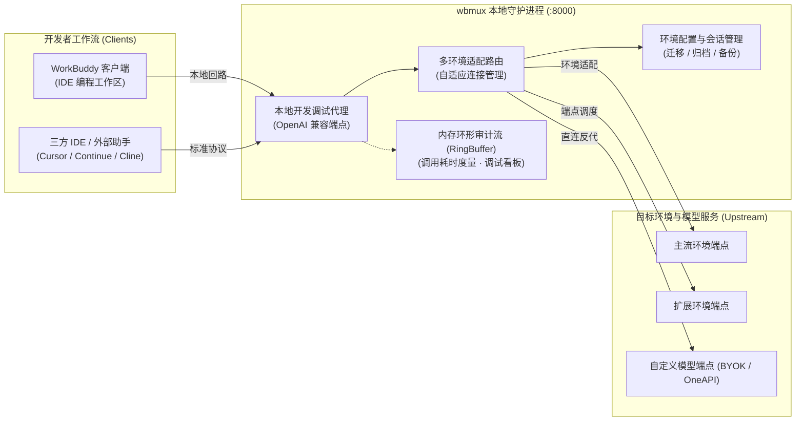

<div align="center">

```text
██     ██ ██████  ███    ███ ██    ██ ██   ██
██     ██ ██   ██ ████  ████ ██    ██  ██ ██ 
██  █  ██ ██████  ██ ████ ██ ██    ██   ███  
██ ███ ██ ██   ██ ██  ██  ██ ██    ██  ██ ██ 
 ███ ███  ██████  ██      ██  ██████  ██   ██
```

### **WorkBuddy 开发者工作区协同套件 · 本地环境迁移 · 会话归档 · 调试代理**

连接多端开发环境，支持历史会话跨 IDE 归档导出、环境配置平滑迁移与本地开发调试代理

<p align="center">
  <b>简体中文</b> • <a href="README_EN.md">English</a>
</p>

<p align="center">
  <a href="https://github.com/HMuSeaB/wbmux/releases/latest"></a>
  <a href="https://go.dev/"></a>
  <a href="https://github.com/HMuSeaB/wbmux/releases"></a>
  <a href="LICENSE"></a>
  <a href="#-基准与指标"></a>
</p>

<p align="center">
  <a href="#-设计背景与概览">设计背景</a> •
  <a href="#-系统架构拓扑">架构拓扑</a> •
  <a href="#-核心工程特性">核心特性</a> •
  <a href="#-快速上手">快速上手</a> •
  <a href="#-三方-ide-与外部工具接入">生态接入</a> •
  <a href="#-参与贡献与反馈">参与贡献</a>
</p>

</div>

---

## 📖 设计背景与概览

`wbmux` 是专为现代开发者打造的高性能本地多环境协同配置工具与工作区开发套件。

在使用 WorkBuddy（国内版 `CodeBuddy` 与国际版 `WorkBuddy AI`）及各类主流 AI 编程助手时，开发者常常面临跨端环境割裂、历史会话难以统一管理、配置重复拷贝等痛点：
- **多端环境隔离**：不同发行版在本地拥有独立的存储结构与会话库，两端历史无法互通；
- **会话难以归档**：Cursor、Qoder、ZCode 等工具中的宝贵排障排错与架构对话分散在各个 SQLite 库中，难以一键导出为 Markdown 项目交接件；
- **配置迁移成本高**：在两端不同安装之间手动搬运自定义模型、技能和记忆繁琐易错。

`wbmux` 采用纯 Go 语言编写，编译为单一无依赖可执行文件，为开发者提供开箱即用的工作区协同支持：
- **历史会话中心**：跨 IDE 自动归组解析历史对话，支持一键导出 Markdown 移交件；
- **环境迁移与体检**：非侵入式读取安装状态，一键同步双端技能、记忆与配置；
- **标准调试代理**：内置轻量 OpenAI 兼容开发代理，支持自定义模型接入与本地延迟度量；
- **配置备份与导出**：支持当前开发配置的安全备份与多设备一键迁移。

---

## 🏛️ 系统架构拓扑



---

## ✨ 核心工程特性

### 1. 📚 跨 IDE 会话中心与 Markdown 移交件导出
* **多源历史会话归组**：支持原地索引并结构化解析本地 Cursor、Qoder、ZCode 等多种 AI 编程工具的历史会话；
* **Markdown 一键导出**：支持将长对话、代码块与思路决策一键导出为标准 Markdown 文档，极速生成项目交接件与复盘记录。

### 2. 🔄 多安装环境配置平滑迁移与健康体检 (Doctor)
* **安全迁移机制**：支持在不同安装实例之间安全同步配置、自定义技能与记忆内容，绝不覆盖已有数据；
* **一键环境体检**：内置 `wbmux doctor`，秒级诊断当前客户端安装路径、配置完整性与连通性。

### 3. 🔌 本地开发调试代理与自定义模型接入 (BYOK)
* **标准 OpenAI 协议兼容**：提供本地回环补全端点，方便第三方桌面工具（如 Cherry Studio、NextChat、Cursor）统一接入；
* **自定义模型映射**：支持将自备 API Key（如 DeepSeek、Moonshot、Ollama 等端点）映射注入至客户端模型列表，统一交互入口。

### 4. 📊 实时请求调试看板与链路耗时度量
* **内存环形审计流**：采用定长 1000 条轻量环形缓冲区，原地复用，零垃圾回收开销；
* **度量指标透明**：毫秒级度量首字响应延迟 (TTFT)、总耗时与 Token 统计，提供现代可视化调试看板。

### 5. 🛡️ 配置文件安全导出与灾备备份
* **交互式导出管理**：Web 界面支持按账号单选或全选一键导出为官方格式 `.json` 备份文件；
* **跨设备平滑还原**：重装系统或切换开发设备时，一键载入配置，快速恢复工作区状态。

### 6. 🚀 极致单二进制交付 (Zero Dependency)
* **零运行时依赖**：无 Node.js、Python 或外部动态库依赖，双击即可运行；
* **全内嵌现代化 WebUI**：前端静态资源通过 Go `embed` 编译进单一可执行文件，极低资源占用。

---

## 🚀 快速上手

### 1. 下载与启动

在 [Releases](https://github.com/HMuSeaB/wbmux/releases) 页面下载对应系统的压缩包，解压后直接运行：

```bash
# 启动图形管理界面（Windows 下双击 wbmux.exe 效果相同）
wbmux gui

# 检查当前系统环境与配置完整性
wbmux doctor

# 查看本机探测到的客户端安装
wbmux list
```

### 2. 常用命令速查

```bash
# 启动图形界面（托盘常驻，退出点界面右下角或托盘菜单）
wbmux gui

# 执行系统与配置体检
wbmux doctor

# 浏览与归组跨 IDE 历史会话
wbmux sessions

# 迁移多环境配置与技能记忆（带 --yes 实际执行，默认只读预览）
wbmux migrate

# 在桌面创建快捷启动方式
wbmux shortcut
```

---

## 🛠️ 三方 IDE 与外部工具接入

由于内置调试代理完全兼容标准 OpenAI 协议规范，您可以直接将三方开发工具指向本地回路：

| 客户端 | 接口地址 (Base URL) | API Key | 推荐模型名 |
|---|---|---|---|
| **Cherry Studio** | `http://127.0.0.1:8000/v1` | 界面右上角生成的安全 Token | `deepseek-chat` / `auto` |
| **NextChat** | `http://127.0.0.1:8000` | 界面右上角生成的安全 Token | `deepseek-chat` |
| **Cursor / Continue** | `http://127.0.0.1:8000/v1` | 界面右上角生成的安全 Token | `auto` |

---

## 🤝 参与贡献与反馈

欢迎提交 Issue 与 Pull Request！在贡献代码时，请遵循以下规范：
- 保持单一可执行文件交付哲学，避免引入重型外部运行时依赖；
- 所有修改需通过自动化测试：`go test ./...`；
- 遵循最小修改原则，确保对现有本地安装目录的零侵入。

---

## 📄 开源许可证与免责声明

本项目基于 [MIT 许可证](LICENSE) 开源。

**免责声明**：本项目为独立的第三方辅助工具，旨在方便开发者管理本地工作区与迁移历史配置，与腾讯、WorkBuddy 或 CodeBuddy 无从属或商业背书关系。
