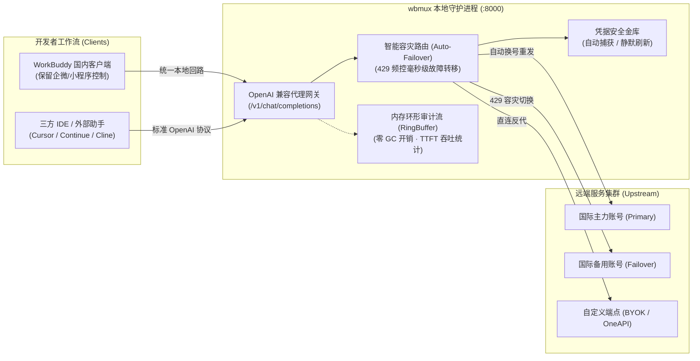

<div align="center">

```text
██     ██ ██████  ███    ███ ██    ██ ██   ██
██     ██ ██   ██ ████  ████ ██    ██  ██ ██ 
██  █  ██ ██████  ██ ████ ██ ██    ██   ███  
██ ███ ██ ██   ██ ██  ██  ██ ██    ██  ██ ██ 
 ███ ███  ██████  ██      ██  ██████  ██   ██
```

### **WorkBuddy 多端协同编排器 · 本地模型网关 · 凭据金库 · 智能容灾**

让单一客户端无缝汇聚全生态能力，解锁限免大模型与全自动凭据生命周期

<p align="center">
  <b>简体中文</b> • <a href="README_EN.md">English</a>
</p>

<p align="center">
  <a href="https://github.com/HMuSeaB/wbmux/releases/latest"></a>
  <a href="https://go.dev/"></a>
  <a href="https://github.com/HMuSeaB/wbmux/releases"></a>
  <a href="LICENSE"></a>
  <a href="#-基准与指标"></a>
</p>

<p align="center">
  <a href="#-设计背景与概览">设计背景</a> •
  <a href="#-系统架构拓扑">架构拓扑</a> •
  <a href="#-核心工程特性">核心特性</a> •
  <a href="#-基准与指标">基准与指标</a> •
  <a href="#-快速上手">快速上手</a> •
  <a href="#-三方-ide-与外部工具接入">生态接入</a> •
  <a href="#-参与贡献与反馈">参与贡献</a>
</p>

</div>

---

## 📖 设计背景与概览

`wbmux` 是面向现代开发者的高性能本地多后端协同编排器与 OpenAI 兼容模型网关。

WorkBuddy 国内版（`CodeBuddy`）与国际版（`WorkBuddy AI`）底层架构一脉相承，但其打包产物、运行配置、认证体系与远端网关彼此隔离：
- **国内版客户端**：原生支持微信小程序与企业微信的远程 Agent 控制与会话漫游；
- **国际版生态**：提供前沿模型矩阵、高额赠送积分包以及 0.00x 费率限免模型（如 DeepSeek、Hy4 等）。

传统多端工作流通常需要重复安装两套客户端（冗余占用 1.3 GB+ 磁盘），且频繁在不同窗口间手动迁移配置。`wbmux` 通过环境动态注入、本地代理网关与官方拟真协议，从底层打通双端隔离：

- **单端兼得双生态**：仅保留国内版即可直连国际端限免模型与自选付费模型；
- **远程控制全保留**：所有本地转发请求维持官方心跳规范，小程序与企微远程控制 100% 可用；
- **纯粹单可执行文件**：Go 语言编写，编译期全量内嵌，零动态链接依赖。

---

## 🏛️ 系统架构拓扑



---

## ✨ 核心工程特性

### 1. 官方拟真 OAuth 授权与无感凭据金库
* **一键流转**：模拟官方浏览器端授权流程，浏览器授权完成后由本地安全回环自动接收 Token。
* **零抓包依赖**：无需开发者打开 F12 控制台或配置抓包代理，AccessToken 与长期 RefreshToken 自动持久化至本地安全目录。

### 2. 凭据全自动自愈保鲜 (Autonomous Token Keep-Alive)
* **主动探活换新**：后台守护协程实时感知凭据到期时间，临期前（< 2 小时）静默发起协议换新。
* **401 动态拦截**：网关层实时拦截上游凭据失效错误，自动原地完成 Token 续期并透明重发当前请求，保障长任务不中断。

### 3. 多账号智能容灾路由 (Auto-Failover)
* **账号池化管理**：支持集中托管主号、备用号与活动赠券账号。
* **毫秒级故障转移**：遇到上游 `429 Too Many Requests` 或额度耗尽时，路由层即刻从健康池挑选可用账号完成请求重定向，对上层调用方完全透明。

### 4. 模型矩阵弹性注入 (0.00x 限免 + 自选付费 + 自备 BYOK)
* **0.00x 限免自动映射**：自动拉取国际端限免模型列表，无缝注入国内版客户端下拉菜单。
* **自选付费模型勾选**：控制台直观呈现各模型官方倍率，勾选即入国内端，支持悬停一键快速移出。
* **BYOK 自由接入**：支持配置任意第三方 OpenAI 兼容端点（如 DeepSeek 官方 API、本地 Ollama 或自建聚合服务）。

### 5. 实时调用分析与低开销审计看板
* **定长内存环形缓冲区 (RingBuffer)**：以 1,000 条为上限在内存中循环复用切片，杜绝高并发下的 GC 停顿与内存抖动。
* **全链路性能审计**：毫秒级度量首字响应时间 (TTFT)、完整往返用时与 Token 吞吐，提供可视化 KPI 仪表盘与实时请求流水。

### 6. 统一资产透视与成长任务闭环
* **资产全景看板**：聚合透视国内积分、海外各批次赠送包余额、过期时限与抵扣优先级。
* **日常活跃同步**：日常编程问答自动关联官方成长中心每日活跃判定，支持在管理界面一键领取打卡奖励。

---

## ⚡ 基准与指标

| 指标维度 | 表现参数 | 技术实现原理 |
|---|---|---|
| **二进制体积** | **~24 MB** | Go 纯静态编译，全静态资源嵌入 (`embed.FS`)，零外部 DLL |
| **常驻内存占用** | **~14 MB** | 零 GC 内存环形缓冲区，轻量协程调度 |
| **网关代理附加延迟** | **< 1.2 ms** | 原生 `httputil.ReverseProxy` 优化与零拷贝流式转发 |
| **容灾故障转移速度** | **< 80 ms** | 内存级健康探测，遇 429 立即换号原地上游重发 |
| **冷启动耗时** | **< 15 ms** | 极简配置解析与本地端口即时绑定 |

---

## 🚀 快速上手

### 下载运行
从 [GitHub Releases](https://github.com/HMuSeaB/wbmux/releases/latest) 获取适合当前系统的预编译单文件：

```bash
# 启动本地管理大屏（双击 wbmux.exe 效果完全相同）
wbmux gui

# 执行环境健康体检（检查安装路径、端口绑定与网络连通性）
wbmux doctor

# 查看本机探测到的所有客户端版本与安装目录
wbmux list
```

服务启动后，系统将自动唤起默认浏览器访问受保护的管理控制台：
```text
http://127.0.0.1:<随机可用端口>/?t=<本地安全临时访问令牌>
```

---

## 🔌 三方 IDE 与外部工具接入

`wbmux` 启动后默认在本地开放标准 OpenAI 兼容端口，可直接作为底层网关为各类编程助手供能：

* **API Base URL**: `http://127.0.0.1:<端口>/v1`
* **API Key**: 填入管理控制台 URL 中的 `t` 校验参数（或控制台启动日志中的 GUI Token）

### 常用工具接入矩阵

| 接入客户端 | Base URL 配置 | API Key | 推荐模型标识 |
|---|---|---|---|
| **VS Code / Continue** | `http://127.0.0.1:<port>/v1` | `<GUI-Token>` | `claude-3-7-sonnet`, `deepseek-chat` |
| **Cline / Roo Code** | `http://127.0.0.1:<port>/v1` | `<GUI-Token>` | `claude-3-7-sonnet`, `gpt-4o` |
| **Cursor (OpenAI Compatible)** | `http://127.0.0.1:<port>/v1` | `<GUI-Token>` | `deepseek-chat`, `deepseek-reasoner` |
| **Cherry Studio / Chatbox** | `http://127.0.0.1:<port>/v1` | `<GUI-Token>` | 全部注入的国际限免与自选模型 |

---

## 🛠️ CLI 常用命令速查

```bash
# 控制台与图形界面
wbmux gui                  # 启动本地现代化管理大屏（默认绑定 127.0.0.1 安全回路）
wbmux doctor               # 执行运行环境、配置与网络拓扑健康诊断

# 客户端定向运行
wbmux run intl --dry-run   # 预览将要注入的环境变量与配置（不实际唤起客户端）
wbmux run cn               # 按国内后端模式启动客户端
wbmux run intl             # 按国际后端模式启动客户端

# 账号与会话管理
wbmux checkin claim        # 触发成长中心打卡并领取今日积分奖励
wbmux migrate              # 分析两端可无损互相迁移的会话与历史（安全只读分析）
wbmux sessions             # 跨 IDE 会话工作区中心（按项目归组浏览，支持 --web）
```

---

## 🤝 参与贡献与反馈

开源生态因协作而长青，我们十分重视每一位开发者的反馈：

- 🐛 **问题报告与需求提议**：欢迎通过 [GitHub Issues](https://github.com/HMuSeaB/wbmux/issues) 提交详实的复现步骤或功能灵感；
- 💡 **代码贡献**：欢迎 Fork 本项目并提交规范的 Pull Request；
- ⭐ **项目支持**：如果 `wbmux` 简化了你的开发日常，欢迎在 GitHub 为本项目点亮一颗 **Star**。

---

## ⚠️ 免责声明

本项目属于社区独立的第三方开源工具，旨在解决跨环境配置协调与合法本地网关中转需求。本项目与腾讯公司、WorkBuddy 或 CodeBuddy 均无任何官方隶属或商业关联。使用本工具时，请严格遵守相关产品及服务提供方的最终用户协议。


