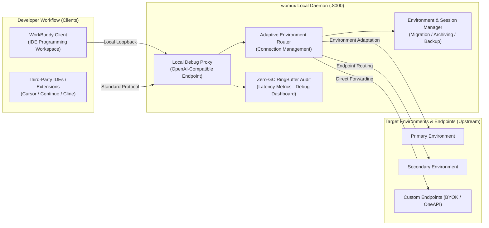

<div align="center">

```text
██     ██ ██████  ███    ███ ██    ██ ██   ██
██     ██ ██   ██ ████  ████ ██    ██  ██ ██ 
██  █  ██ ██████  ██ ████ ██ ██    ██   ███  
██ ███ ██ ██   ██ ██  ██  ██ ██    ██  ██ ██ 
 ███ ███  ██████  ██      ██  ██████  ██   ██
```

### **WorkBuddy Developer Workspace Suite · Environment Migration · Session Archiving · Debug Proxy**

Bridge multi-edition developer environments, cross-IDE session archiving, smooth profile migrations, and local debug proxying.

<p align="center">
  <a href="README.md">简体中文</a> • <b>English</b>
</p>

<p align="center">
  <a href="https://github.com/HMuSeaB/wbmux/releases/latest"></a>
  <a href="https://go.dev/"></a>
  <a href="https://github.com/HMuSeaB/wbmux/releases"></a>
  <a href="LICENSE"></a>
  <a href="#-benchmarks--footprint"></a>
</p>

<p align="center">
  <a href="#-overview">Overview</a> •
  <a href="#-system-architecture">Architecture</a> •
  <a href="#-core-features">Core Features</a> •
  <a href="#-quick-start">Quick Start</a> •
  <a href="#-ide--external-integrations">Integrations</a> •
  <a href="#-contributing--feedback">Contributing</a>
</p>

</div>

---

## 📖 Overview

`wbmux` is a lightweight, high-performance local developer workspace suite and environment coordination toolkit tailored for **WorkBuddy** and modern AI-assisted engineering workflows.

When using WorkBuddy (`CodeBuddy` and `WorkBuddy AI`) alongside mainstream AI coding assistants, developers often face fragmented environments, isolated conversation histories, and tedious manual profile synchronization:
- **Environment Isolation**: Separate distributions maintain independent local storage structures and databases;
- **Scattered Sessions**: Critical debugging dialogues and architecture decisions in tools like Cursor, Qoder, and ZCode are scattered across local SQLite files with no simple way to archive or hand over;
- **Repetitive Configuration**: Manually copying custom skills, project memories, and preferences across installations is error-prone.

Written in pure Go and compiled into a single dependency-free executable, `wbmux` offers out-of-the-box workspace collaboration:
- **Cross-IDE Session Hub**: Automatically index and group history sessions across editors, enabling one-click Markdown handoff exports;
- **Environment Doctor & Migration**: Non-invasively inspect installation integrity and smoothly sync skills, memories, and configurations;
- **Standard Debug Proxy**: Built-in lightweight OpenAI-compatible development proxy supporting custom model endpoints and local latency measurement;
- **Profile Backup & Vault**: Securely export and back up workspace configurations for seamless multi-device restoration.

---

## 🏛️ System Architecture



---

## ✨ Core Features

### 1. 📚 Cross-IDE Session Hub & Markdown Handoff Export
* **Multi-Source Session Indexing**: In-place discovery and structural parsing of history conversations across Cursor, Qoder, ZCode, and WorkBuddy;
* **One-Click Markdown Export**: Turn long discussions, code snippets, and decision trails into standardized Markdown documents for rapid project handoff and review.

### 2. 🔄 Smooth Environment Migration & System Health Doctor
* **Safe Profile Synchronization**: Securely sync configuration, custom skills, and workspace memory between different installations without overwriting existing data;
* **One-Click Health Diagnostics**: Built-in `wbmux doctor` diagnoses installation paths, configuration completeness, and network connectivity in seconds.

### 3. 🔌 Local Development Debug Proxy & Custom Model Integration (BYOK)
* **OpenAI Protocol Compliance**: Provides standard local loopback completion endpoints for seamless integration with desktop tools like Cherry Studio, NextChat, or Cursor;
* **Custom Model Mapping**: Bring your own API keys (e.g. DeepSeek, Moonshot, Ollama) and map them directly into your client dropdowns with a unified entry point.

### 4. 📊 Real-Time Request Debug Dashboard & Latency Metrics
* **Zero-Allocation RingBuffer**: Fixed-capacity 1,000-record circular buffer guarantees predictable performance without garbage collection overhead;
* **Transparent Latency Metrics**: Precise millisecond-level measurement of **Time to First Token (TTFT)**, total request duration, and token throughput on a modern visual dashboard.

### 5. 🛡️ Profile Security Export & Disaster Recovery
* **Interactive Export Management**: Easily select individual accounts or batch-export full configurations to official `.json` backup files via the WebUI;
* **Seamless Multi-Device Restoration**: Quickly reload configurations and restore workspace environments after OS reinstallation or device replacement.

### 6. 🚀 Pure Single-Binary Delivery (Zero Dependency)
* **Zero External Runtimes**: No Node.js, Python, or system DLL requirements—ready to run out of the box;
* **Statically Embedded Modern WebUI**: Frontend assets are compiled into the binary via Go `embed.FS` for minimal memory and disk footprint.

---

## ⚡ Benchmarks & Footprint

| Metric | Measured Baseline | Underlying Engineering |
|---|---|---|
| **Binary Size** | **~24 MB** | Pure Go static compilation with embedded WebUI (`embed.FS`) |
| **Resident Memory** | **~14 MB** | Zero-GC in-memory ring buffers and lightweight goroutine pools |
| **Proxy Overhead** | **< 1.2 ms** | Optimized `httputil.ReverseProxy` with zero-copy stream forwarding |
| **Cold Start** | **< 15 ms** | Instant configuration initialization and port binding |

---

## 🚀 Quick Start

### 1. Download & Launch

Grab the pre-built single binary for your operating system from [GitHub Releases](https://github.com/HMuSeaB/wbmux/releases/latest):

```bash
# Launch the local management dashboard (equivalent to double-clicking wbmux.exe on Windows)
wbmux gui

# Run environment and configuration integrity diagnostics
wbmux doctor

# Inspect detected local client installations
wbmux list
```

### 2. Common CLI Commands

```bash
# Start Web UI console (resident in tray; quit from UI bottom-right or tray menu)
wbmux gui

# Run system and configuration health check
wbmux doctor

# Browse and index cross-IDE history sessions
wbmux sessions

# Migrate environment settings, skills, and memory (use --yes to execute; defaults to dry-run)
wbmux migrate

# Create a desktop shortcut (Windows)
wbmux shortcut
```

---

## 🛠️ Third-Party IDE & Tool Integrations

Because the built-in debug proxy strictly conforms to the OpenAI specification, you can connect any third-party development tool directly to local loopback:

| Client / Tool | Base URL | API Key | Recommended Model Identifier |
|---|---|---|---|
| **Cherry Studio** | `http://127.0.0.1:8000/v1` | Ephemeral Security Token from WebUI top-right | `deepseek-chat` / `auto` |
| **NextChat** | `http://127.0.0.1:8000` | Ephemeral Security Token from WebUI top-right | `deepseek-chat` |
| **Cursor / Continue** | `http://127.0.0.1:8000/v1` | Ephemeral Security Token from WebUI top-right | `auto` |

---

## 🤝 Contributing & Feedback

Issues and Pull Requests are warmly welcomed! When contributing, please ensure:
- Adhere to the single self-contained binary philosophy without heavy external dependencies;
- All automated unit tests pass: `go test ./...`;
- Maintain the principle of minimal disruption and non-invasive handling of local installation directories.

---

## 📄 License & Disclaimer

This project is licensed under the [MIT License](LICENSE).

**Disclaimer**: `wbmux` is an independent third-party utility designed to help developers manage local workspaces, archive sessions, and migrate developer configurations. It is not affiliated with, endorsed by, or sponsored by Tencent, WorkBuddy, or CodeBuddy.

