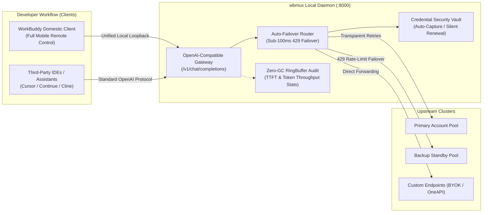

<div align="center">

```text
██     ██ ██████  ███    ███ ██    ██ ██   ██
██     ██ ██   ██ ████  ████ ██    ██  ██ ██ 
██  █  ██ ██████  ██ ████ ██ ██    ██   ███  
██ ███ ██ ██   ██ ██  ██  ██ ██    ██  ██ ██ 
 ███ ███  ██████  ██      ██  ██████  ██   ██
```

### **Multi-Backend Orchestrator · Local OpenAI Gateway · Credential Vault · Auto-Failover**

Bridge domestic and international WorkBuddy ecosystems seamlessly from a single client installation.

<p align="center">
  <a href="README.md">简体中文</a> • <b>English</b>
</p>

<p align="center">
  <a href="https://github.com/HMuSeaB/wbmux/releases/latest"></a>
  <a href="https://go.dev/"></a>
  <a href="https://github.com/HMuSeaB/wbmux/releases"></a>
  <a href="LICENSE"></a>
  <a href="#-benchmarks--footprint"></a>
</p>

<p align="center">
  <a href="#-overview">Overview</a> •
  <a href="#-system-architecture">Architecture</a> •
  <a href="#-core-features">Core Features</a> •
  <a href="#-benchmarks--footprint">Benchmarks</a> •
  <a href="#-quick-start">Quick Start</a> •
  <a href="#-ide--external-integrations">Integrations</a> •
  <a href="#-contributing--feedback">Contributing</a>
</p>

</div>

---

## 📖 Overview

`wbmux` is a lightweight, high-performance local orchestrator, credential lifecycle vault, and OpenAI-compatible proxy gateway crafted specifically for developers using **WorkBuddy (CodeBuddy)**.

Although the domestic (`CodeBuddy`) and international (`WorkBuddy AI`) editions share the identical core runtime, their distribution installers, storage namespaces, authentication pipelines, and upstream gateway endpoints are strictly separated:
- **Domestic Edition**: Native support for WeChat Mini Program and WeCom remote agent control channels;
- **International Edition**: Access to premier frontier models, recurring promotional credit allocations, and zero-cost 0.00x promotional models (e.g. DeepSeek, Hy4).

Installing two duplicate Electron clients wastes over **1.3 GB** of disk space and fractures workspace configuration. `wbmux` eliminates this friction through dynamic environment redirection, transparent protocol emulation, and an embedded local proxy gateway:

- **Unify Both Ecosystems**: Access international promotional and premium models directly from the domestic client;
- **Preserve Remote Control**: All local proxy traffic satisfies official heartbeat requirements—mobile remote control remains 100% operational;
- **Single Self-Contained Binary**: Written in pure Go with statically embedded assets—zero external dependencies or dynamic link libraries.

---

## 🏛️ System Architecture



---

## ✨ Core Features

### 1. Authentic Browser OAuth Flow & Zero-DevTools Vault
* **One-Click Authorization**: Faithfully reproduces official web authentication flows without manual header inspection or DevTools extraction.
* **Autonomous Ingestion**: Safely captures ephemeral `AccessToken`s and long-lived `RefreshToken`s directly into the local encrypted credential vault.

### 2. Autonomous Token Keep-Alive & Self-Healing
* **Preemptive Renewal**: Background telemetry monitors token expiration and silently refreshes credentials when less than 2 hours remain.
* **Dynamic 401 Interception**: Intercepts upstream authentication failures at the gateway layer, refreshes tokens on the fly, and transparently replays in-flight requests without interrupting active coding sessions.

### 3. Intelligent Multi-Account Auto-Failover
* **Pooled Account Management**: Centralize primary, secondary, and promotional credit accounts.
* **Sub-100ms Failover**: Upon encountering upstream `429 Too Many Requests` or quota exhaustion, traffic automatically switches to the next healthy account in milliseconds.

### 4. Elastic Model Injection (0.00x Free + Premium + BYOK)
* **Zero-Cost Model Discovery**: Dynamically queries and injects promotional 0.00x rate models into the domestic client dropdown.
* **Selective Premium Exposure**: Inspect official billing multipliers and toggle premium frontier models into your local client with instant hover-to-remove ergonomics.
* **Bring Your Own Key (BYOK)**: Connect arbitrary OpenAI-compatible endpoints including official DeepSeek API, local Ollama, or self-hosted aggregators.

### 5. High-Throughput Audit Dashboard & Latency Metrics
* **Zero-Allocation RingBuffer**: Fixed-capacity 1,000-record circular buffer guarantees predictable performance without garbage collection spikes.
* **Granular Telemetry**: Precise recording of **Time to First Token (TTFT)**, total turnaround time, token throughput, and real-time reverse-chronological request streams.

### 6. Unified Credit Overview & Growth Center Automation
* **Lifecycle Visibility**: Aggregated breakdown of domestic credits, international bonus allocations, expiration horizons, and deduction priorities.
* **Activity Synchronization**: Everyday programming queries automatically contribute to official Growth Center daily check-in streaks with one-click reward claiming.

---

## ⚡ Benchmarks & Footprint

| Metric | Measured Baseline | Underlying Engineering |
|---|---|---|
| **Binary Size** | **~24 MB** | Pure Go static compilation with embedded WebUI (`embed.FS`) |
| **Resident Memory** | **~14 MB** | Zero-GC in-memory ring buffers and lightweight goroutine pools |
| **Proxy Overhead** | **< 1.2 ms** | Optimized `httputil.ReverseProxy` with zero-copy stream forwarding |
| **Failover Latency** | **< 80 ms** | Fast health state routing with in-place upstream retry |
| **Cold Start** | **< 15 ms** | Instant configuration initialization and port binding |

---

## 🚀 Quick Start

### Installation
Grab the pre-built single binary for your operating system from [GitHub Releases](https://github.com/HMuSeaB/wbmux/releases/latest):

```bash
# Launch the local management dashboard (equivalent to double-clicking wbmux.exe)
wbmux gui

# Run environment and network connectivity diagnostics
wbmux doctor

# Inspect detected local installations and version details
wbmux list
```

Upon launch, the daemon automatically opens your default browser to the secure local dashboard:
```text
http://127.0.0.1:<random-port>/?t=<secure-ephemeral-token>
```

---

## 🔌 IDE & External Integrations

`wbmux` exposes a standard OpenAI-compatible `/v1` endpoint on localhost, allowing you to power external IDEs, extensions, and CLI agents:

* **Base URL**: `http://127.0.0.1:<port>/v1`
* **API Key**: Enter the `t` parameter from your dashboard URL (or the token printed in terminal logs)

### Client Configuration Matrix

| Tool / Extension | Base URL | Auth Bearer Key | Recommended Model Identifier |
|---|---|---|---|
| **VS Code / Continue** | `http://127.0.0.1:<port>/v1` | `<GUI-Token>` | `claude-3-7-sonnet`, `deepseek-chat` |
| **Cline / Roo Code** | `http://127.0.0.1:<port>/v1` | `<GUI-Token>` | `claude-3-7-sonnet`, `gpt-4o` |
| **Cursor (OpenAI Compatible)** | `http://127.0.0.1:<port>/v1` | `<GUI-Token>` | `deepseek-chat`, `deepseek-reasoner` |
| **Cherry Studio / Chatbox** | `http://127.0.0.1:<port>/v1` | `<GUI-Token>` | All injected models & custom endpoints |

---

## 🛠️ CLI Reference

```bash
# Dashboard & Diagnostics
wbmux gui                  # Start local web management console (bound to 127.0.0.1)
wbmux doctor               # Perform environment, configuration, and network health checks

# Target Launch Operations
wbmux run intl --dry-run   # Preview injected environment flags without launching client
wbmux run cn               # Launch client bound to domestic backend
wbmux run intl             # Launch client bound to international backend

# Account & Session Utilities
wbmux checkin claim        # Claim daily check-in rewards from official Growth Center
wbmux migrate              # Analyze cross-edition session migration candidates (read-only)
wbmux sessions             # Browse cross-IDE sessions grouped by workspace (supports --web)
```

---

## 🤝 Contributing & Feedback

Open source thrives on community collaboration. We welcome and appreciate your contributions:

- 🐛 **Bug Reports & Proposals**: Open an [Issue](https://github.com/HMuSeaB/wbmux/issues) with detailed reproduction steps or feature proposals;
- 💡 **Pull Requests**: Fork the repository and submit clean, well-tested PRs;
- ⭐ **Show Your Support**: If `wbmux` saves you time and disk space, please consider starring this repository on GitHub!

---

## ⚠️ Disclaimer

`wbmux` is an independent, community-driven open-source project created for local developer environment orchestration and lawful gateway proxying. It is not affiliated with, maintained by, or endorsed by Tencent, WorkBuddy, or CodeBuddy. Please adhere to the terms of service of respective product providers.

